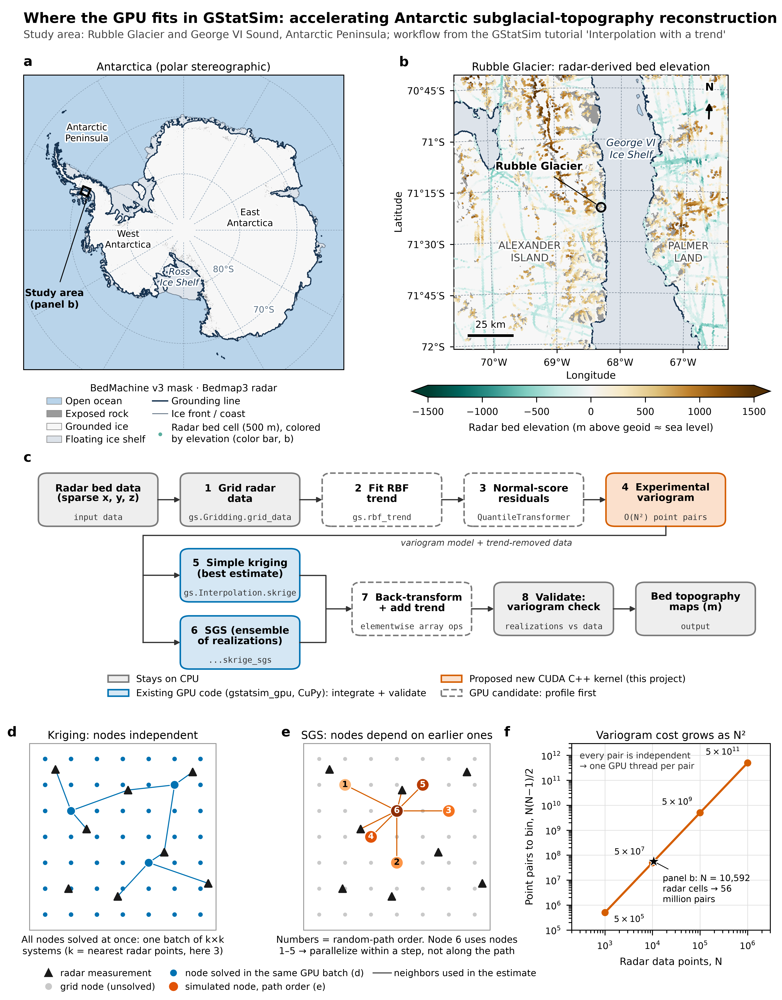

# 🧊⚡ gstatsim-accel: GPU-accelerated bed topography mapping

**Same geostatistics, faster.** This project adds an opt-in GPU backend to
[GStatSim](https://github.com/GatorGlaciology/GStatSim) so kriging and sequential
Gaussian simulation (SGS) of subglacial topography can run on an NVIDIA GPU, with
the original CPU code kept as the trusted reference.

> Final project for GLY4930, University of Florida, Fall 2026.

---

## 🎯 Objectives

1. **Profile** GStatSim to find where kriging and SGS actually spend their time.
2. **Accelerate** the bottleneck on the GPU (CuPy) without changing the algorithm.
3. **Validate** GPU results against GStatSim's CPU output within stated tolerances.
4. **Apply** it to map the bed of Rubble Glacier with multiple SGS realizations, and
   **measure** the speedup honestly, including cases where the GPU is slower.

## 🗺️ Study area: Rubble Glacier, Antarctic Peninsula

Rubble Glacier flows from Alexander Island into George VI Sound, on the western
Antarctic Peninsula. The domain is a 200 × 200 km box in polar stereographic
coordinates (EPSG:3031): x −2,000,250 to −1,800,250 m, y 650,250 to 850,250 m.
Radar bed picks are sparse and clustered along flight lines (panel b below), which
is exactly where geostatistical interpolation and simulation are needed.

## 🛠️ Methods



*(a) Location. (b) Radar-derived bed elevation around Rubble Glacier. (c) The GStatSim
workflow and which steps are GPU candidates. (d) Kriging nodes are independent, so they
can be solved in one GPU batch. (e) SGS nodes depend on earlier ones, which limits
parallelism. (f) Variogram cost grows as N².*

- **Kriging (simple and ordinary):** each grid cell is estimated from its nearest radar
  points (octant search, as in GStatSim). Cells are independent, so the GPU builds
  and solves thousands of small kriging systems at once.
- **SGS:** cells are simulated along a random path, each one conditioned on the data
  *and* on the cells simulated before it. The GPU version must keep that order, so it
  speeds up the work within each step rather than skipping the dependency.
- **One API, two backends:**
  ```python
  from gstatsim_accel import kriging
  est, var = kriging.predict(df, grid_xy, vario, num_points=100, radius=50_000,
                             method="simple", backend="gpu")   # or "cpu"
  ```
  `backend="cpu"` calls GStatSim unchanged (tested to give identical output).
  `backend="gpu"` stops with a clear error if no GPU is present; it never falls back
  to the CPU on its own, so a "GPU" timing is always really a GPU timing.
- **Benchmarks** record hardware, software versions, settings and raw timings for
  every run, so results can be reproduced.

## 📊 Results

> 🚧 **In progress.** Planned figures: CPU vs GPU runtime across grid sizes, CPU–GPU
> difference maps, and Rubble Glacier bed realizations (`figures/realizations/`).

First measurement (laptop CPU, Tutorial 3 data): GStatSim simple kriging takes
**~10 ms per grid cell**, and **~80% of that is the neighbor search**, not the
linear algebra. That's why the GPU version batches the neighbor search as well as
the solves. Details: [docs/existing_port_review.md](docs/existing_port_review.md).

## 🚀 Getting started

```bash
git clone https://github.com/<your-username>/gstatsim-gpu.git
cd gstatsim-gpu
conda env create -f environment.yml
conda activate gstatsim-gpu
pytest                                   # 37 tests, about 15 s
python scripts/env_report.py --label mymachine   # checks the GPU works
```

No NVIDIA GPU? Delete the `cupy-cuda12x[ctk]` line from `environment.yml` first;
the CPU backend works without it.

**Tutorial 3 benchmark** (data: `demos/data/greenland_test_data.csv` from the
GStatSim repo, copied to `data/`):

```bash
python benchmarks/bench_kriging.py --csv data/greenland_test_data.csv --method simple --repeats 3
```

**On HiPerGator:** see [docs/hipergator.md](docs/hipergator.md).

### Dependencies

Python 3.12 · GStatSim 1.1.5 · NumPy 2.2 · pandas 2.2 · SciPy 1.15 · scikit-learn 1.6 ·
scikit-gstat · tqdm · psutil · pytest · CuPy 14 (`cupy-cuda12x[ctk]`, GPU only).
Exact versions are in [environment.yml](environment.yml).

## 📁 Files

| Path | What it does |
|---|---|
| `src/gstatsim_accel/kriging.py` | `predict()`: the notebook-facing kriging function; picks the CPU or GPU backend |
| `src/gstatsim_accel/backend.py` | Detects whether a usable GPU is present; raises `BackendUnavailableError` if not |
| `src/gstatsim_accel/validation.py` | Checks inputs (shapes, NaNs, variogram, search settings) before either backend runs |
| `src/gstatsim_accel/bench.py` | Benchmark timing (warm-up, repeats) and JSON run records |
| `src/gstatsim_accel/envinfo.py` | Collects hardware and software versions for each record |
| `benchmarks/bench_kriging.py` | Runs the Tutorial 3 kriging workload; saves timings and outputs |
| `benchmarks/compare_outputs.py` | Compares two runs' outputs (e.g. CPU vs GPU) against a tolerance |
| `scripts/env_report.py` | Environment report plus a GPU smoke test |
| `scripts/hpg/env_report.sbatch` | Runs the environment report on a HiPerGator L4 GPU |
| `tests/` | Unit tests: backend selection, input checks, CPU output = GStatSim, benchmark tools |
| `figures/prep_map_data.py` | Crops BedMachine and Bedmap3 to the study area for the figure |
| `figures/make_method_figure.py` | Draws `method_figure.png/.pdf/.svg` (above) |
| `figures/data/` | Small cropped arrays the figure script reads |
| `docs/existing_port_review.md` | Review of an earlier CuPy port of GStatSim, and the first CPU profile |
| `docs/hipergator.md` | Course HiPerGator limits, setup and job submission |
| `TRACKER.md` | Project plan, milestones, open questions, decisions and benchmark log |
| `environment.yml`, `pyproject.toml` | Conda environment and package definition |

## 🙏 Acknowledgements and data

- **GStatSim:** MacKie, E. J., et al. (2023). GStatSim V1.0: a Python package for
  geostatistical interpolation and conditional simulation. *Geoscientific Model
  Development*, 16, 3765–3783. https://doi.org/10.5194/gmd-16-3765-2023. The CPU
  reference, the Tutorial 3 data and the overall workflow come from GStatSim and its
  [Jupyter Book](https://gatorglaciology.github.io/gstatsimbook/).
- **BedMachine Antarctica v3:** Morlighem, M. (2022). MEaSUREs BedMachine Antarctica,
  Version 3. NASA NSIDC DAAC. https://doi.org/10.5067/FPSU0V1MWUB6. Also: Morlighem,
  M., et al. (2020). *Nature Geoscience*, 13, 132–137.
  https://doi.org/10.1038/s41561-019-0510-8
- **Bedmap3:** Pritchard, H. D., et al. (2025). Bedmap3 updated ice bed, surface and
  thickness gridded datasets for Antarctica. *Scientific Data*, 12, 414.
  https://doi.org/10.1038/s41597-025-04672-y
- **Earlier GPU port:** ideas for batched solves and grid-stencil neighbor search
  come from [badger-lord/gstatsim_gpu](https://github.com/badger-lord/gstatsim_gpu).
  No code was copied.
- **CuPy:** Okuta, R., et al. (2017). CuPy: A NumPy-compatible library for NVIDIA GPU
  calculations. *Proceedings of LearningSys, NeurIPS*.
- **Computing:** UFIT Research Computing, HiPerGator.
- Thanks to the Gator Glaciology Lab and the GLY4930 teaching team.

## 📜 License

[MIT](LICENSE)
