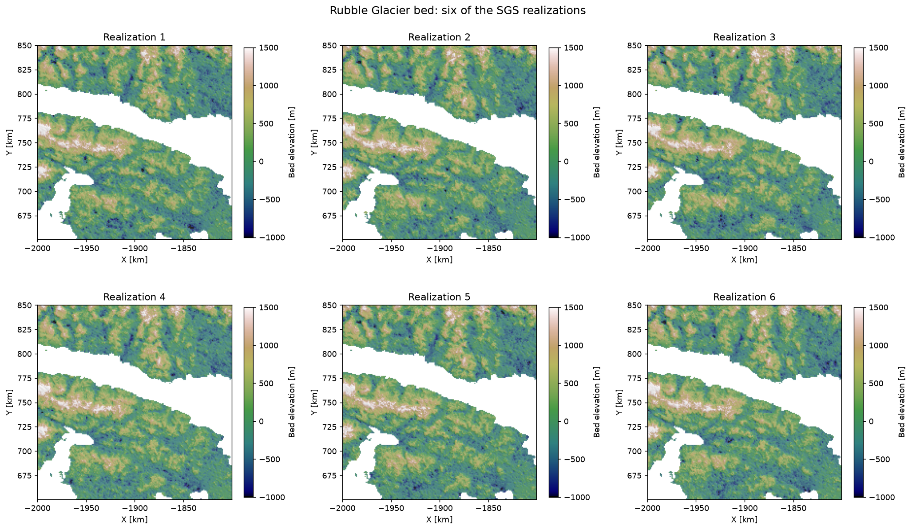
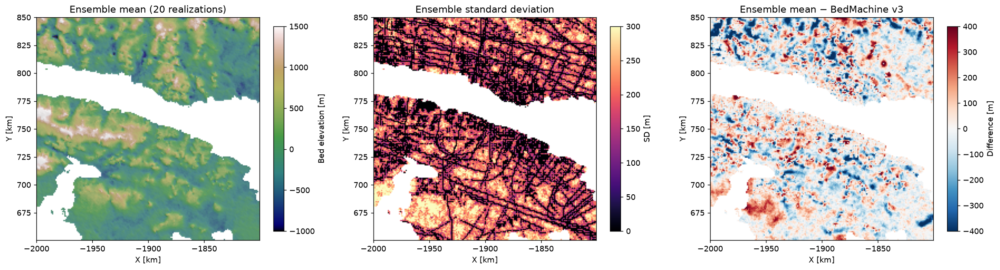

# 🧊⚡ gstatsim-accel: GPU-accelerated bed topography mapping

[](https://github.com/alexislanier0420-tech/gstatsim-gpu/actions/workflows/ci.yml)   

**Same geostatistics, faster.** This project adds an opt-in GPU backend to
[GStatSim](https://github.com/GatorGlaciology/GStatSim) so kriging and sequential
Gaussian simulation (SGS) of subglacial topography can run on an NVIDIA GPU, with
the original CPU code kept as the trusted reference.

> Final project for GLY4930, University of Florida, Fall 2026.

---

## 🎯 Objectives

1. **Profile** GStatSim to find where kriging and SGS actually spend their time.
2. **Accelerate** the bottleneck on the GPU (CuPy) without changing the algorithm.
3. **Validate** GPU results against GStatSim's CPU output within stated tolerances.
4. **Apply** it to map the bed of Rubble Glacier with multiple SGS realizations, and
   **measure** the speedup honestly, including cases where the GPU is slower.

## 🗺️ Study area: Rubble Glacier, Antarctic Peninsula

Rubble Glacier flows from Alexander Island into George VI Sound, on the western
Antarctic Peninsula. The domain is a 200 × 200 km box in polar stereographic
coordinates (EPSG:3031): x −2,000,250 to −1,800,250 m, y 650,250 to 850,250 m.
Radar bed picks are sparse and clustered along flight lines (panel b below), which
is exactly where geostatistical interpolation and simulation are needed.

## 🛠️ Methods


*(a) Location. (b) Radar-derived bed elevation around Rubble Glacier. (c) The GStatSim
workflow and which steps are GPU candidates. (d) Kriging nodes are independent, so they
can be solved in one GPU batch. (e) SGS nodes depend on earlier ones, which limits
parallelism. (f) Variogram cost grows as N².*

- **Kriging (simple and ordinary):** each grid cell is estimated from its nearest radar
  points (octant search, as in GStatSim). Cells are independent, so the GPU builds
  and solves thousands of small kriging systems at once.
- **SGS:** cells are simulated along a random path, each one conditioned on the data
  *and* on the cells simulated before it. The GPU version keeps that order exactly.
  Its parallelism comes from running many realizations side by side, one node each
  per step, which you need anyway to map uncertainty.
- **Data:** radar bed (BedMachine surface minus Bedmap3 radar ice thickness) plus
  rock outcrops, where the bed is the surface, gridded to 1 km. A smooth trend is
  removed, the residuals are normal-score transformed, and simulation covers rock
  and grounded ice (not the George VI Ice Shelf, where there are no bed data).
- **One API, two backends:**
  ```python
  from gstatsim_accel import kriging
  est, var = kriging.predict(df, grid_xy, vario, num_points=100, radius=50_000,
                             method="simple", backend="gpu")   # or "cpu"
  ```
  `backend="cpu"` calls GStatSim unchanged (tested to give identical output).
  `backend="gpu"` stops with a clear error if no GPU is present; it never falls back
  to the CPU on its own, so a "GPU" timing is always really a GPU timing.
- **Benchmarks** record hardware, software versions, settings and raw timings for
  every run, so results can be reproduced.

## 📊 Results

### 🏔️ Rubble Glacier bed: 20 SGS realizations on the GPU



Each map is an equally likely bed that honors the radar and rock-outcrop data and the
variogram. Where they disagree is where the bed is uncertain:



*Left: ensemble mean. Middle: standard deviation; near zero along radar flight lines
and on rock, larger between them. Right: ensemble mean minus BedMachine v3 (mean
absolute difference 110 m).* The realizations reproduce the data's histogram and
variogram ([figures/results/realization_checks.png](figures/results/realization_checks.png)).

### 📚 The GStatSim book on the GPU

GPU versions of the [GStatSim Jupyter Book](https://gatorglaciology.github.io/gstatsimbook/)
chapters, same text and data, with only the slow calls swapped
([notebooks/book/](notebooks/book/README.md)):

| Book chapter | Book (GStatSim, CPU) | GPU |
|---|---|---|
| 3 Simple & ordinary kriging | 4 min 11 s | **3.9 s** |
| 4 Sequential Gaussian simulation | 7 min 58 s | **20 s** |
| 5 Interpolation with anisotropy | 10 min 25 s | **35 s** |
| 6 Non-stationary SGS (k-means clusters) | 6 min 00 s | **29 s** |
| 7 Non-stationary SGS (adaptive partitioning) | 6 min 19 s | **29 s** |
| 8 Interpolation with a trend | 5 min 23 s | **21 s** |
| 9 Cokriging & cosimulation (MM1) | 6 min 41 s | **21 s** |

Every chapter with a slow step now runs on the GPU (chapters 1–2 only fit variograms, which take seconds).

### ⚡ Speed (laptop, NVIDIA RTX 5060 8 GB)

| Workload | GStatSim 1.2.0 | Our NumPy version | **GPU** |
|---|---|---|---|
| Tutorial 3 simple kriging, 22,500 cells | 158 s | 19.8 s | **0.91 s (173×)** |
| Book ch. 4 SGS, 22,500 cells, per realization | ~150 s | — | **~18 s alone; 0.8 s with 32 together** |
| Rubble Glacier simple kriging, 40,000 cells | ~2 min (est.) | — | **2.3 s (~53×)** |
| Rubble Glacier SGS, 30,750 cells, per realization | 146 s | — | 90 s alone; **6.0 s with 50 together (24×)** |

SGS is sequential within a realization, so it runs as a custom **CUDA kernel**: one
thread block walks a realization's whole random path (neighbor search, covariance
matrix, Cholesky solve, sample) without returning to Python, and realizations run
as separate blocks at the same time. One realization is ~8× faster than GStatSim;
many together are far faster. Full log: [TRACKER.md](TRACKER.md#benchmark-log).

### ✅ Does the GPU give the same answers?

Yes, judged by criteria written down *before* any GPU result
([TRACKER.md](TRACKER.md#acceptance-criteria-written-2026-10-29-before-gpu-results)):

- Kriging and fixed-seed SGS match GStatSim to **~1e-13** whenever the choice of
  neighbors is unambiguous.
- Where two data points are exactly equidistant, GStatSim's pick between them is
  arbitrary (its sort isn't stable); here the earlier data row wins. Every
  differing cell checked was such a tie.
- On a grid, ties make single SGS realizations diverge, so whole ensembles were
  compared: GPU and GStatSim ensembles agree in mean, variance and variogram as well
  as two GStatSim ensembles agree with each other.

Profiling showed **~80% of GStatSim's kriging time is its neighbor search**, not the
linear algebra, so the GPU version batches the search as well as the solves.

## 🚀 Getting started

```bash
git clone https://github.com/alexislanier0420-tech/gstatsim-gpu.git
cd gstatsim-gpu
conda env create -f environment.yml
conda activate gstatsim-gpu
pytest                                   # 37 tests, about 15 s
python scripts/env_report.py --label mymachine   # checks the GPU works
```

No NVIDIA GPU? Delete the `cupy-cuda12x[ctk]` line from `environment.yml` first;
the CPU backend works without it.

**Run the notebook:** register the env as a Jupyter kernel once, then open
`notebooks/rubble_glacier_workflow.ipynb` and pick **Python (gstatsim-gpu)**:

```bash
python -m ipykernel install --user --name gstatsim-gpu --display-name "Python (gstatsim-gpu)"
```

**Tutorial 3 benchmark** (data: `demos/data/greenland_test_data.csv` from the
GStatSim repo, copied to `data/`):

```bash
python benchmarks/bench_kriging.py --csv data/greenland_test_data.csv --method simple --repeats 3
```

**On HiPerGator:** see [docs/hipergator.md](docs/hipergator.md).

### Development

```bash
pip install -e ".[dev]"     # pytest + ruff
pytest                      # GPU tests skip automatically without a CUDA GPU
ruff check .                # lint (also runs in CI and as a pre-commit hook)
```

Every push runs the linter and the tests on Python 3.10–3.12 (GitHub Actions).

### Dependencies

Python 3.12 · GStatSim 1.1.5 · NumPy 2.2 · pandas 2.2 · SciPy 1.15 · scikit-learn 1.6 ·
scikit-gstat · matplotlib · Jupyter (ipykernel, nbconvert) · tqdm · psutil · pytest · CuPy 14 (`cupy-cuda12x[ctk]`, GPU only).
Exact versions are in [environment.yml](environment.yml).

## 📁 Files

| Path | What it does |
|---|---|
| `notebooks/rubble_glacier_workflow.ipynb` | **The full workflow**: data → trend → variogram → GPU kriging → SGS ensemble → figures |
| `src/gstatsim_accel/kriging.py` | `predict()` and `cokrige_mm1()`: kriging and cokriging, CPU or GPU |
| `src/gstatsim_accel/simulation.py` | `sgs()`, `realizations()`, `cluster_sgs()` and `cosim_mm1()`: one or many realizations, CPU or GPU |
| `src/gstatsim_accel/_batched.py` | Batched octant search and kriging, written once for NumPy and CuPy |
| `notebooks/book/` | GPU versions of GStatSim book chapters 3–9 ([details](notebooks/book/README.md)) |
| `src/gstatsim_accel/_sgs_cuda.py` | **CUDA kernel** for SGS: a whole realization per thread block, one launch |
| `src/gstatsim_accel/_sgs.py` | CuPy/NumPy SGS (fallback for settings the kernel doesn't support, and the CPU check) |
| `scripts/make_book_gpu_notebooks.py` | Builds `notebooks/book/` from a checkout of the GStatSim book |
| `src/gstatsim_accel/backend.py` | Detects whether a usable GPU is present; raises `BackendUnavailableError` if not |
| `src/gstatsim_accel/validation.py` | Checks inputs (shapes, NaNs, variogram, search settings) before either backend runs |
| `src/gstatsim_accel/bench.py` | Benchmark timing (warm-up, repeats) and JSON run records |
| `src/gstatsim_accel/envinfo.py` | Collects hardware and software versions for each record |
| `benchmarks/bench_kriging.py` | Runs the Tutorial 3 kriging workload; saves timings and outputs |
| `benchmarks/compare_outputs.py` | Compares two runs' outputs (e.g. CPU vs GPU) against a tolerance |
| `benchmarks/bench_rubble_sgs.py` | Times one full GStatSim SGS realization vs GPU ensembles on the Rubble Glacier inputs |
| `benchmarks/validate_sgs_ensemble.py` | Checks GPU SGS ensembles against two GStatSim ensembles (statistics + variogram) |
| `figures/realizations/` | Bed realizations, ensemble mean and standard deviation maps |
| `figures/results/` | Input map, variogram, kriging maps and realization checks from the notebook |
| `scripts/env_report.py` | Environment report plus a GPU smoke test |
| `scripts/hpg/env_report.sbatch` | Runs the environment report on a HiPerGator L4 GPU |
| `tests/` | 84 tests: GPU and NumPy kriging/SGS vs GStatSim, tie handling, backend selection, input checks |
| `figures/prep_map_data.py` | Crops BedMachine and Bedmap3 to the study area (radar bed, rock outcrops, mask) |
| `figures/make_method_figure.py` | Draws `method_figure.png/.pdf/.svg` (above) |
| `figures/data/` | The cropped study-area data (0.7 MB) the notebook and figure read |
| `docs/existing_port_review.md` | Review of an earlier CuPy port of GStatSim, and the first CPU profile |
| `docs/hipergator.md` | Course HiPerGator limits, setup and job submission |
| `TRACKER.md` | Project plan, milestones, open questions, decisions and benchmark log |
| `environment.yml`, `pyproject.toml` | Conda environment and package definition |

## 🙏 Acknowledgements and data

- **GStatSim:** MacKie, E. J., et al. (2023). GStatSim V1.0: a Python package for
  geostatistical interpolation and conditional simulation. *Geoscientific Model
  Development*, 16, 3765–3783. https://doi.org/10.5194/gmd-16-3765-2023. The CPU
  reference, the Tutorial 3 data and the overall workflow come from GStatSim and its
  [Jupyter Book](https://gatorglaciology.github.io/gstatsimbook/).
- **BedMachine Antarctica v3:** Morlighem, M. (2022). MEaSUREs BedMachine Antarctica,
  Version 3. NASA NSIDC DAAC. https://doi.org/10.5067/FPSU0V1MWUB6. Also: Morlighem,
  M., et al. (2020). *Nature Geoscience*, 13, 132–137.
  https://doi.org/10.1038/s41561-019-0510-8
- **Bedmap3:** Pritchard, H. D., et al. (2025). Bedmap3 updated ice bed, surface and
  thickness gridded datasets for Antarctica. *Scientific Data*, 12, 414.
  https://doi.org/10.1038/s41597-025-04672-y
- **Earlier GPU port:** ideas for batched solves and grid-stencil neighbor search
  come from [badger-lord/gstatsim_gpu](https://github.com/badger-lord/gstatsim_gpu).
  No code was copied.
- **CuPy:** Okuta, R., et al. (2017). CuPy: A NumPy-compatible library for NVIDIA GPU
  calculations. *Proceedings of LearningSys, NeurIPS*.
- **Computing:** UFIT Research Computing, HiPerGator.
- Thanks to the Gator Glaciology Lab and the GLY4930 teaching team.

## 📜 License

[MIT](LICENSE)
